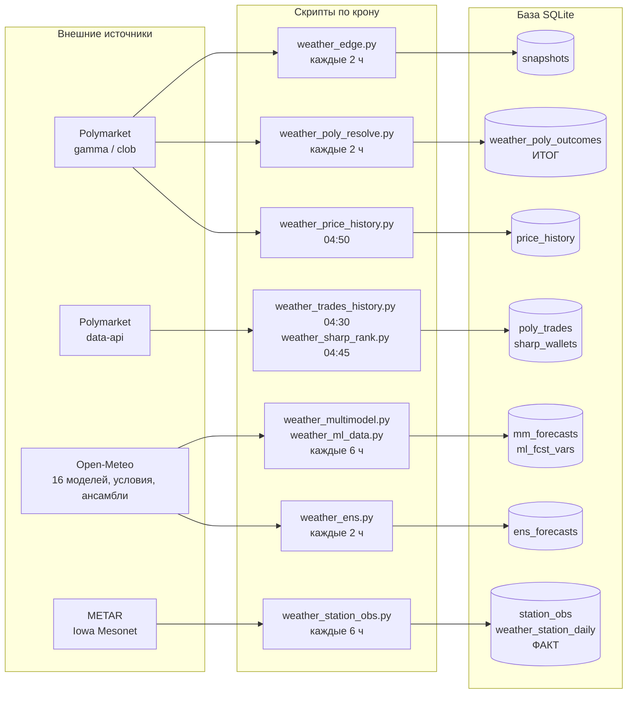
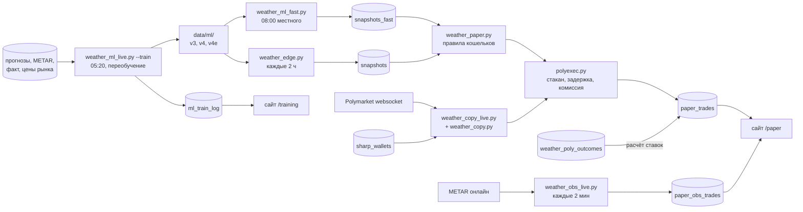
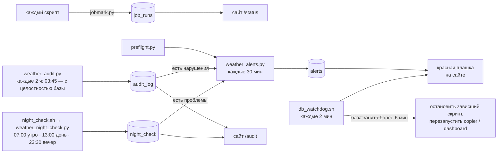

# Архитектура weather-lab

Общая картина: откуда берутся данные, какой скрипт что пишет в базу, как из этого получаются
ставки кошельков и страницы сайта. Правила работы — `CLAUDE.md`, цели — `docs/PRD.md`,
внешний вид сайта — `docs/DESIGN_SYSTEM.md`. Сокращено 19.10; полная прежняя версия — `docs/ARCHITECTURE_archive_2026-10-19.md`.

## 1. Схема

### Сбор данных



### Модель и ставки



### Контроль



## 2. Контейнеры (`docker-compose.yml`)

Список скриптов крона с подписями, расписанием и допустимым опозданием — `app/jobs_info.py`
(его читают `/status` и `weather_alerts.py`). **Меняешь крон — поправь `jobs_info.py`.**
Каждый запуск идёт через `run_job.sh` → `job_wrap.py`: предел времени, запись в `job_log`,
подсчёт запросов к Open-Meteo.

| Контейнер | Режим | Что делает |
|---|---|---|
| `collector` | по крону, `docker compose run --rm collector <скрипт>` | все скрипты `app/*.py`; вход через `app/run_job.sh` (предел времени `JOB_TIMEOUT`, по умолчанию 40 мин) |
| `weather-lab-copier` | постоянно | `weather_copy_live.py` — слушает сделки Polymarket (websocket) и повторяет покупки сильных трейдеров за секунды |
| `weather-lab-dashboard` | постоянно, порт 8093 | `dashboard.py` (FastAPI + Jinja2), снаружи — туннель Cloudflare |

Общие папки: `./app` → `/app`, `./data` → `/data`. Часовой пояс контейнеров — `Europe/Chisinau`.

## 3. Внешние источники

| Источник | Адрес | Зачем | Лимиты |
|---|---|---|---|
| Polymarket Gamma | `gamma-api.polymarket.com` | список маркетов, варианты, итоги | — |
| Polymarket CLOB | `clob.polymarket.com` | живой стакан (исполнение ставок), история цен | — |
| Polymarket Data API | `data-api.polymarket.com` | настоящие сделки (хранит ~30 дней) | — |
| Polymarket WS | `wss://ws-live-data.polymarket.com` | сделки в реальном времени (copier) | — |
| Open-Meteo | `api.`, `ensemble-api.`, `previous-runs-api.`, `historical-forecast-api.open-meteo.com` | 16 погодных моделей, ансамбли, история прогнозов | ~10 тыс. вызовов/сутки, крон тратит 5-6 тыс. |
| Iowa Mesonet | `mesonet.agron.iastate.edu` | METAR — факт температуры (как у Polymarket) | — |
| aviationweather.gov, NOAA tgftp | METAR онлайн | кошелёк `obs` | — |

Личные данные во внешние API не передаются.

## 4. Таблицы базы

`data/db/polymarket_lab.sqlite3`, ~6 ГБ, режим WAL.

### Сырые данные

| Таблица | Кто пишет | Что внутри |
|---|---|---|
| `snapshots` | `weather_edge.py`, `weather_multimodel.py` | снимок каждые 2 ч: цены всех вариантов + шансы всех моделей (колонка на модель) |
| `snapshots_fast` | `weather_ml_fast.py` | то же для обучаемых моделей, ровно в 08:00 местного |
| `mm_forecasts` | `weather_multimodel.py` | прогнозы 16 погодных моделей |
| `ml_fcst_vars` | `weather_ml_data.py` | прогнозные условия (облака, ветер и т. п.) |
| `ens_forecasts` | `weather_ens.py` | ансамбли ECMWF/GEFS/ICON + с 28.09 AIFS/UKMO/GEM (212 вариантов), копятся для проверки (сверка ~28.10) |
| `station_obs` | `weather_station_obs.py` | METAR по часам |
| `weather_station_daily` | `weather_station_obs.py` | **факт**: максимум за день по станции (°F-города — целые °F, `whole_f()`, с 15.10: десятые из группы T давали 65.5 вместо 65) |
| `weather_poly_outcomes` | `weather_poly_resolve.py` (+ `weather_obs_live.py`, `weather_price_history.py`) | **итог** Polymarket: какой вариант выиграл (с 15.10 и доп. города Гонконг/Тайбэй — последние 10 дней) |
| `poly_trades`, `poly_trades_days`, `poly_trade_wallets`, `poly_market_final` | `weather_trades_history.py` | настоящие сделки — по ним проверяется преимущество |
| `price_history`, `price_history_days` | `weather_price_history.py` | история цен (последние сделки, могут быть протухшими) |
| `sharp_wallets` | `weather_sharp_rank.py` | 30 сильных трейдеров для кошелька `copy` |

### Модели и результаты

| Таблица | Кто пишет | Что внутри |
|---|---|---|
| `ml_train_log` | `weather_ml_live.py --train`, `weather_ml_report.py` | ежедневное переобучение, отчёт, экзамен → `/training` |
| `ml_skill` | `weather_ml_skill.py` | «насколько модель права» |
| `ml_preds_wf`, `ml_preds_q`, `ml_preds_var_*` | исследования | прогнозы на истории (проверка «обучил на прошлом — проверил на будущем») |
| `paper_trades` | `weather_paper.py`, `weather_copy*.py` | ставки всех кошельков: покупка, пропуск с причиной, итог |
| `paper_obs_trades`, `metar_seen*` | `weather_obs_live.py` | кошельки `obs` и `obs_fmi` (колонка `wallet`) |

### Служебные

| Таблица | Кто пишет | Что внутри |
|---|---|---|
| `job_runs` | `jobmark.py` (из скриптов и обёртки) | последний успешный запуск |
| `job_log` | `job_wrap.py` (обёртка каждого запуска крона) | каждый запуск: код выхода, длительность, запросы к Open-Meteo, хвост вывода (`output`, до 12 тыс. символов, с 29.09); хранится 14 дней → `/status`, `/events` |
| `alerts` | `weather_alerts.py` | активные тревоги → красная плашка на сайте |
| `night_check` | `weather_night_check.py` (через `night_check.sh`: 07:00 morning «ночь прошла?», 13:00 midday «утренние решения приняты?», 23:30 evening «ночь пройдёт?») | проверки в течение дня, колонка `mode`: код, ставки, крон, база, сервисы, модели к обучению, с 15.10 «Входные данные» (`check_inputs`: таблицы, которые читают скрипты по крону, пополняются; строки письма LLM не пустые) — ok / внимание / проблема с подсказкой «что делать»; выключенные кошельки (`RETIRED`) не проверяются; 60 дней → `/audit` |
| `notes` (отдельный файл `data/db/notes.sqlite3`) | `notes.py`, сайт `/notes` | заметки с датой «что проверить / запустить»; несделанные на сегодня — счётчик в панели и строка «Заметки» в утренней/дневной проверке, вечером — «на завтра»; несделанные на сегодня — плашка вверху всех страниц; `every_days` — повторяющаяся (после «Сделано» ставится следующая) |
| `audit_log` | `weather_audit.py` | результат полной проверки: каждая ставка против правил и итогов, модели, данные, крон, целостность базы; 30 дней → `/audit` |

Устаревшие, больше не пополняются: `weather_outcomes` (факт по Open-Meteo — оказался неверным),
`afd_signals` (разборы метеорологов), `ml_neighbors` (соседние станции).

## 5. Факт и итог

- 48 городов (`weather_cities.py`), маркеты «Highest temperature in X», резолв по METAR.
- **Факт** — `weather_station_daily` (METAR, Iowa Mesonet); **итог** — `weather_poly_outcomes`.
  Совпадают в ~98%; ставки рассчитываются по итогу. 5-минутные замеры США не засчитываются.
- Проверять преимущество — по настоящим сделкам (`poly_trades`), не по `price_history`
  (там последние сделки, могут быть протухшими).
- `/book` уже содержит зеркальные заявки парного токена — стаканы не объединять.

## 6. Модель

- **v3 (`ml3`, главная до 20.10)**: LightGBM, одна на 48 городов, квантильная регрессия (13 уровней) — поправка
  к среднему 16 погодных моделей. Признаки на 08:00 местного: прогнозы и их разброс, прогнозные
  условия, утренние METAR, вчерашняя ошибка, сезон, город, **мнение рынка**. История с 2025-06-01,
  цены рынка тоже (Шэньчжэнь/Париж/Сеул до смены источника — без них, `MKT_UNRELIABLE_BEFORE`).
- **Смесь 35% модели + 65% рынка** лучше и модели, и рынка: модель честна, но самоуверенна в ставках
  (выбор максимального спора с рынком), смесь это лечит.
- **v4** = v3 с 31 листом (`V4_EXTRA`); **v4e** = v4, среднее 3 обучений (зёрна `V4E_SEEDS` 11/22/33).
  v1 (`ml`, одно число), v2 (`ml2`, без рынка) — для сравнения.
- **v5 «от рынка»** (`train_v5`, `q_fm_s11/_s22/_s33`, колонки `ml5_model_p`/`ml5c_model_p`): отправная точка —
  ожидаемый максимум по ценам рынка в 08:00, модель учит поправку к рынку; среднее 3 обучений. Кошельки `ml5` (**главная с 20.10**, решение Alex) и `ml5_cal`. Главную задаёт `MAIN_WALLET` в `dashboard.py` и `weather_alerts.py`, проверка решений — `weather_night_check.py`.
- Код: `weather_ml.py` (`row_for` — **одна** функция признаков для обучения и живого прогноза),
  `weather_ml_q.py` (квантильная регрессия), `weather_ml_live.py` (обучение и живой прогноз).
- Файлы моделей — `data/ml/`: `q_mkt` (v3), `q_mkt31` (v4), `q_mkt31_s11/_s22/_s33` (v4e), `q` (v2), `model.txt` (v1).
- Каждую ночь (05:20) — переобучение на всей истории, отчёт и экзамен в `ml_train_log`.
- Живой прогноз считается в `weather_ml_fast.py` (08:00 местного) и `weather_edge.py` (каждые 2 ч) и пишется
  колонкой в снимок.

## 7. Кошельки и ставки

$100 на кошелёк (`ml`, `mm_mk`, `mm` — $300, `copy` — $1000, `ml3` / `ml3_mk` / `ml3_cal` — $200 с 19.10; `START_BY_WALLET`), ставка $2, минимум 5 долей.

1. `weather_paper.py` берёт самый ранний снимок дня по городу (быстрый 08:00 или обычный). Кошельки из `RETIRED` (с 14.10: main, main_mk, emos, emos_mk, mm, mm_mk, ml, ml_shift) новых ставок не делают — открытые досчитываются, история остаётся, в списках /paper и /models не показываются — только по ссылке /paper?w=… (PRD §10).
2. Раз в день на город — вариант с максимальным перевесом над ценой, если перевес ≥ порога и
   цена 3-95¢; цена покупки не выше «шанс − порог».
3. `polyexec.py` имитирует покупку: живой стакан → пауза 2 с → стакан ещё раз, комиссия
   `доли × 0.05 × p × (1−p)` с того, кто забирает заявку. Нет исполнения — `nofill`, пропуск — `skip`
   (с причиной). Файл `data/STOP` останавливает новые ставки.
4. После итога маркета ставка рассчитывается, кошелёк пересчитывается.

| Кошелёк | Логика |
|---|---|
| **`ml3`** | v3, порог 10 п.п. (главная до 20.10) |
| `ml4` / `ml4_cal`, `ml4e` / `ml4e_cal` | v4 и v4e; и их смеси с рынком, порог 3 п.п. |
| **`ml5`** / `ml5_cal` | **главная с 20.10**: v5 «от рынка» (`train_v5`); чистая (правила ml3) и смесь 35/65 |
| `no_cheap5` / `no_mid5` / `no_big5` / `ml5_cal30` | с 20.10 10:00: двойники `no_cheap` / `no_mid` / `no_big` / `ml3_cal30` — то же правило на смеси v5 (`ml5c_model_p`) |
| `ml5_no` | с 21.10 17:00: двойник `ml3_no` — «нет» при перевесе ≥ 10 п.п. на чистой v5 (`ml5_model_p`) |
| `ml3_cal` | смесь v3 с рынком, порог 3 п.п.; `ml3_cal15` / `ml3_cal30` — не дешевле 15¢ / «да» от 30¢; `ml3_cal_k` — Келли ×0.25 |
| `ml3_city` | как `ml3_cal`, только лучшая половина городов за 45 дней (`CITY_PICK`) |
| `ml3_conf` | как `ml3_cal`, без ставки при фаворите ≥ 60¢ (`CONF_SKIP`) |
| `ml3_no`, `ml3_z`, `ml2` | «нет» на переоценённый; смесь «да» 20-40¢; v2 для сравнения |
| `ml3_mk` | сигнал ml3 своей заявкой (без комиссии, до 12:00) |
| `fav` / `techno` | «да» 50-95¢ недооценённый / «да» 8-30¢ в топ-4 (`YES_BAND`; с 19.10 полоса и по цене покупки) |
| `no_cheap` / `no_mid` / `no_big` | «нет» на 5-15¢ / 30-55¢ / 25-80¢ (`NO_BAND`) |
| `copy` | повтор покупок 30 сильных трейдеров накануне дня маркета, за секунды |
| `ml_day`, `ml_day_fav` | дневная модель 10/12/14 местного (§10) |
| `llm_*` | LLM каждый час и agy (§10) |
| `obs`, `obs_fast`, `obs_wethr`, `obs_fmi` | по замерам станций (§10) |
| `mm_ws_*`, `mm100`, `mm100f` | бот-мейкер (§10, страница /mm) |
| выключены 14-15.10 (`RETIRED`) | main, main_mk, emos, emos_mk, mm, mm_mk, ml, ml_shift, ens, obs_rt |

С 03.10 «да» дешевле 10¢ кошельки моделей не покупают (`YES_MIN`; с 19.10 проверка и по цене покупки).

Подписи и группы на сайте — `WALLET_INFO` в `dashboard.py`; полная логика («Как работает этот
кошелёк») — `app/wallet_docs.py`, preflight проверяет, что описание есть у каждого.

## 8. Надёжность

| Механизм | Где | Что защищает |
|---|---|---|
| WAL | база | чтение сайтом не мешает записи |
| `item_guard` | `jobmark.py`, циклы по городам / трейдерам / дням во всех скриптах крона | ошибка на одном элементе не роняет запуск: элемент пропускается (запись откатывается), остальные идут дальше; число пропусков — `job_log.item_errors`, на /status «с пропусками» |
| `JOB_TIMEOUT` + `job_wrap.py` | `app/run_job.sh` | зависший скрипт убивается (крупные задачи: `-e JOB_TIMEOUT=10800` и т. п. в кроне) |
| `db_watchdog.sh` | крон */2 | база занята >6 мин → останавливает зависшие скрипты, при необходимости перезапускает copier/dashboard, пишет `data/ALERT_DB_LOCKED` |
| `preflight.py` / `./check.sh` | каждые 30 мин / после изменений | сборка скриптов, колонки, прогон всех кошельков в памяти, страницы; правила на известных примерах; тесты данных `data_tests.py` (расчёт ставок по итогу, шансы моделей/LLM в сумме 1, сводки = архив IEM, быстрые замеры не «убивают» победителя, итоги = финальные цены) |
| `weather_alerts.py` | крон */30 | сбои крона, упавшие проверки, потеря >$50/сутки |
| `backup_db.sh` | 03:10 (с 02.10, решение Alex) | все базы data/db, с 11.10 и стаканы `data/books` + архив `research.tar.zst` (скрипты и итоги исследований, без research.sqlite3) → `/mnt/personal_data/Backups/Projects/Weather Polymarket/ГГГГ-ММ-ДД/` (HDD): VACUUM INTO (без блокировки записи), quick_check, zstd (7.2 ГБ → ~1 ГБ, ~2 мин); 7 дней + воскресенья 4 недели; итог — `data/backup_status.json`, проверяет night_check; с 11.10 `backup_report.py` (Python сервера) пишет `data/backup_history.jsonl` (каждый запуск, по каждой базе размер до/после сжатия и quick_check) и `data/backup_inventory.json` (папки копий, диск, что не входит) — страница `/backup` |

Исследования — только на копии `data/research/research.sqlite3`, иначе крон ловит «database is locked».

## 9. Сайт (`dashboard.py`)

| Страница | Что показывает | Основные таблицы |
|---|---|---|
| `/paper` | все кошельки → `?w=<кошелёк>`: счёт, открытые ставки сценариями, история | `paper_trades`, `ml_skill`, `job_runs`, `alerts` |
| `/training` | ночное обучение, отчёт, экзамен, график «Учится ли модель» (`training_progress()` → `progress_chart()`, блок `templates/_progress.html`, общий с /llm) | `ml_train_log`, `ml_day_exam` |
| `/models`, `/models/<ключ>` | каждая модель целиком: против рынка (история/вживую, по неделям, накопительно), экзамены после обучений, деньги всех её кошельков, города, важность признаков, «как работает» | `ml_skill`, `ml_train_log`, `paper_trades`; описания и привязка модель → кошельки — `app/models_info.py` |
| `/audit` | автоматическая проверка: нарушения правил кошельков, модели, данные, база, крон; история последних проверок | `audit_log` |
| `/bets` | все ставки всех кошельков: ждут итога (по времени закрытия) и закрытые за 7 дней, движение денег за 14 дней, фильтр по кошельку | `paper_trades`, `paper_obs_trades` |
| `/api/stream` | живое обновление: соединение Server-Sent Events, сервер раз в 3 с сверяет отпечаток данных (`/api/version`: ставки, итоги, снимки, проверки, обучение, тревоги, заметки; частые скрипты без ставок не считаются) и при изменении шлёт сигнал — `base.html` подгружает ту же страницу и подменяет `<main>` без перезагрузки | всё перечисленное |
| `/cities` | итог по каждому городу, где ставили (все кошельки или один): плюс/минус, доходность, угадано, случайность | `paper_trades`, `paper_obs_trades` |
| `/cities/<город>` | всё по городу: итог по кошелькам; каждый день — итог маркета, что показывали рынок и главная модель в 08:00, решение каждого кошелька с причиной и результатом | + `weather_poly_outcomes`, `weather_station_daily`, `snapshots` |
| `/services` | все внешние сервисы (что даёт, API коротко, по расписанию / исследования, ключ в `.env` — только имя, цена) и подписки (цена, когда заканчивается, дней осталось; расход OpenRouter за месяц — живой). Список ведётся руками в `app/services_info.py` — новый сервис, ключ или подписку дописывать туда | `llm_hour_preds` |
| `/notes` | заметки с датой: добавить, «Сделано», удалить (сайт пишет только в `notes.sqlite3`, рабочую базу — только читает) | `notes.sqlite3` |
| `/events` | лента событий за 3 дня: обучение, загрузка данных, итоги маркетов, ставки сводкой по часам, тревоги, ошибки; у каждого — раскрывающееся «что произошло»: лог запуска (`job_log.output`), маркеты с выигравшим вариантом и нашими ставками, ставки по одной, итоги обучения | `job_log`, `ml_train_log`, `weather_poly_outcomes`, ставки, `alerts` |
| `/status` | здоровье системы: скрипты крона (успех, ошибки, опоздания), тревоги, база и диск, стоп ставок, расход Open-Meteo | `job_runs`, `job_log`, `alerts`, логи `data/logs/` |

## 10. Папки и подсистемы

```
weather-lab/
├── app/                   скрипты, сайт, шаблоны (app/templates), скилл (app/agy_skill/)
├── data/
│   ├── db/                рабочая база + отдельные: notes, mm, fastobs, pws, netatmo
│   ├── books/             свои стаканы (books.sqlite3, вне ночной копии)
│   ├── research/          копия базы и исследования (data/research/*.py, логи)
│   ├── ml/                файлы моделей
│   ├── agy/, agy_box/     очередь писем agy и изолированная коробка скилла
│   ├── logs/              логи крона
│   └── STOP / MAINTENANCE стоп новых ставок / пропуск крона
├── docs/                  PRD, ARCHITECTURE, DESIGN_SYSTEM, журнал, архивы
├── check.sh, night_check.sh, db_watchdog.sh, backup_db.sh, backup_report.py
├── agy_runner.py, agy_box.sh, claude_box.sh, gemma_box.py   (Python/крон сервера, не контейнер)
```

Подробные описания (как было до 19.10, со всеми датами и прошлыми версиями) — `docs/ARCHITECTURE_archive_2026-10-19.md`.
Скрипты `weather_study_*.py`, `*_backtest.py`, `data/research/*.py` — разовые исследования, не в кроне.

**Кошельки по замерам** (`paper_obs_trades`, итог — `weather_obs_live.settle`):
- `obs` — `weather_obs_live.py` (*/2 мин). Для °F-городов замер в целых °C — нижняя граница (`safe_value`). Гонконг/Тайбэй —
  `weather_cities.EXTRA_OBS_CITIES`, Гонконг — через `bet_dead_buckets`. С маркетов на 23.10 (новые правила Polymarket во всех
  47 городах) — только плановые сводки, SPECI не считается (`routine_only`, у tgftp — по минуте сводки); Денвер — KDEN вместо
  KBKF (`weather_cities.station_for` / `STATION_FROM`, так же в `weather_ml_day`). 22.10 Денвер переведён целиком: `icao`/`iem` в
  `OBS_CITIES` — станция сегодняшнего маркета города (меняется сама в местную полночь 23.10), история и обучение — `history_iem()`
  (KDEN), прогнозы — в точке KDEN; старые замеры KBKF — `station_obs.city = 'old:denver'`, копия до переноса —
  `data/research/denver_kbkf_backup_2210.sqlite3`.
- `obs_fast` — `weather_fastobs.py` (каждую минуту): JMA, KNMI, DWD, FMI, HKO, RCSS → `data/db/fastobs.sqlite3` (`fast_obs`);
  максимум в минуты сводки METAR, запас `ROUND_MARGIN`; без ставок — `NO_BET_SOURCES` (KNMI с 12.10, FMI с 15.10); Synoptic
  выключен 12.10. Фора — `weather_fastobs_report.py`. `obs_fmi` — ставок нет с 15.10 (`FMI_BETS = False`).
- `obs_wethr` — `weather_obs_wethr.py` (крон :07, 57.5 мин), поток wethr.net (`WETHR_API_KEY`), 5 станций США; подписка отменена,
  **крон снять 31.10**. Использует функции выключенного `weather_obs_rt.py` (`buy_dead`, источники в `metar_seen_src`).
- `weather_logic_check.py` (пн и чт 09:00) — правила замеров против итогов Polymarket, группа «Логика» на /audit.

**Дневная модель** `ml_day` — `weather_ml_day.py`: обучение `--train` 05:45 (утренние строки v3 × часы 10/12/14, `day_feats()` —
одна функция для обучения и решения, 3 зерна → `data/ml/day_s*/`), затем экзамен `exam()` → `ml_day_exam`. Решения — крон `:06`:
смесь 35/65 → `ml_day_preds`, одна ставка на город в день при перевесе ≥ 3 п.п. Тот же запуск ставит `ml_day_fav` («да» 50-95¢,
`FAV_BAND`, с 19.10 и по цене покупки). `ml5` — чистая v5 по правилам ml3.

**LLM каждый час** — `weather_llm_hour.py`, крон `5,56 * * * *` (`slot()`, `due()`, замок `/data/logs/.weather_llm_hour.lock`).
Города `CITIES` (5 США + Лондон), 08-19 местного. Письмо: METAR с полуночи, почасовой Open-Meteo, `mm_forecasts`, цены, свои
прогнозы за 7 дней, утренний v3 (`lgbm_forecast`, `bias_stats`, `bet_summary`, `calibration`) → OpenRouter (`OPENROUTER_API_KEY`;
Gemini напрямую в Google при `GEMINI_DIRECT`, отказ → OpenRouter; DeepSeek — провайдер StreamLake, `PROVIDER_DS`) →
`llm_hour_preds`. Ставка — `bet()`: лучший перевес ≥ 5 п.п., 10-90¢ (и по цене покупки), $2. Лимит — `MONTH_LIMIT`.
Без своих запросов: `llm_mix` (Gemini + v3 поровну, `mix_probs`), `llm_cal` (Gemini 35% + рынок, `CAL_EDGE`). Тетрадь и разбор часа
выключены 13.10 (`NOTEBOOK_ON = False`). **Настройки заморожены до 31.10.** Страница **/llm** (`llm_page_data()`).

**agy (Gemini через Antigravity CLI)** — `llm_agy`, `llm_agy_bet`, `llm_agy_nomem`: письма кладутся в `data/agy/queue/`,
`agy_runner.py` (крон сервера каждую минуту) отдаёт их `agy -p`, ответ — `data/agy/done/`; ждём до `AGY_WAIT`; лимит Google →
пауза (`data/agy/paused_until`). Ответ — `{"max_f"}`, шансы — код (`agy_probs`, разброс `agy_sigma` по `AGY_BLOCKS`). Доп. города
`AGY_EXTRA_CITIES`. `llm_agy_bet` — сама решает ставку в рамках `AGY_BET_*`; `llm_agy_nomem` — без памяти (`nomem=True`).

**Скилл agy с Python** (проверка на прошлом, живого кошелька нет; страница **/skill**, `app/skill_status.py`):
- Папка на день — `app/agy_skill.py ДАТА` → `data/agy_box/skill*/<дата>/`: `SKILL.md`, `tools.py`, `cities.json`, CSV станции
  и прогнозов — строго до дня письма.
- Коробка: **`agy_box.sh`** + `Dockerfile.agybox` (образ `weather-lab-agybox`: без проекта, `.env` и базы, корень только для
  чтения, `--cap-drop ALL`). `agy --sandbox` не защищает — только коробка.
- Прогон — `data/research/agy_skill_bt.py` (letters / run / score), запуск только `data/research/haiku_run.sh`.
  Движок `BT_ENGINE`:
  - `agy` — Gemini, бюджет `gemini_week.txt` и `BT_BUDGET`;
  - `claude` — `claude_box.sh`, ключ `data/agy_box/claude_token` (не читать);
  - `gemma` — **`gemma_box.py`**, Ollama в виртуальной машине на NAS, RTX 2060, команды в той же коробке с `--network none`;
  - `or` — тот же `gemma_box.py` через OpenRouter, стоп при балансе < $5.
  - С 20.10 каждый шаг `gemma_box.py` (размышление, команда, вывод, ответ, повторы обвязки) сразу пишется в
    `data/research/agy_trace/<набор><движок><тег>/<письмо>.jsonl` (`GEMMA_TRACE`); терминал /skill показывает его вживую
    (`skill_status.live_traces`). Другая версия скилла на тех же письмах — `BT_SKILL_DIR`.
- Ответы — `agy_skill_bt_<набор><движок><BT_TAG>.jsonl`. Сравнение кругов — `agy_skill_pair.py`, моделей — `model_compare.py`.

**Бот-мейкер** — `weather_mm_ws.py` (крон каждый час, 57 мин): живой канал стаканов, заявка переставляется при каждом изменении,
исполнения — `mm_ws_fills` (`data/db/mm.sqlite3`); расчёт — `weather_mm_settle.py` (`settle_ws`, каждые 2 ч). Кошельки:
`mm_ws_all` / `mm_ws_sel` / `mm_ws_zone` / `mm_ws_z30` / строгий `mm_ws_zs`; `mm100` (банк $100, `bank100()`, `mm100_state`), `mm100f`
(`focus_cities()`, FOCUS_N=5, FOCUS_CAP=5); `mm_ws_ml` — только исполнения, где модель `weather_mm_ml.py` (обучение 03:40,
`data/ml/mm_ws_ml/`) ждёт плюс. Тот же бот пишет свои стаканы раз в 60 с → `data/books/books.sqlite3` `book_snaps` (формат Falcon).
Расписание сводок — `mm_metar_minutes.json`. Старый опросный бот `weather_mm_paper.py` и не погода остановлены 02.10 (`POLL_OFF`).
Страница `/mm`, `/mm/<код>`. Долгие скрипты берут замок `jobmark.single_instance`, «жив» — `jobmark.mark_alive`.

**Сбор без ставок:**
- Netatmo — `weather_netatmo.py` (*/5 мин) → `data/db/netatmo.sqlite3`; токен меняется — `data/db/netatmo_token.json`.
- CWOP — `weather_pws_live.py` (11:00-19:00) → `data/db/pws.sqlite3` `cwop_obs`.
- Ансамбли — `weather_ens.py` (признак в v3 — проверка 10.01.2027).

**Недельный разбор:** `weather_research.py` (свежая копия базы `data/research/research.sqlite3`; с 20.10 — каждый день в 06:40 по крону, ~100 с) → `weather_week_review.py`; порядок — `docs/RESEARCHER.md`,
итоги — `docs/RESEARCH_JOURNAL.md`.

**ИИ с дневником** (с 21.10, исследование): `app/diary_lab.py`, запуск `./diary_run.sh`, данные и дневник — `data/research/diary/<город>/`; устройство — `docs/DIARY.md`.

## Обслуживание базы

- `price_history` и `poly_trades` — WITHOUT ROWID, ключ `poly_trades` — `(condition_id, ts, tx, asset, price, size, side)` (02.10, 7.1 → 3.95 ГБ).
- Режим обслуживания: файл `data/MAINTENANCE` — `run_job.sh` пропускает крон (постоянные процессы остановить вручную).
  После: удалить файл, `docker compose start copier`, `./check.sh`.
