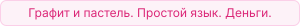
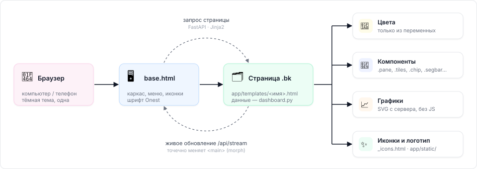
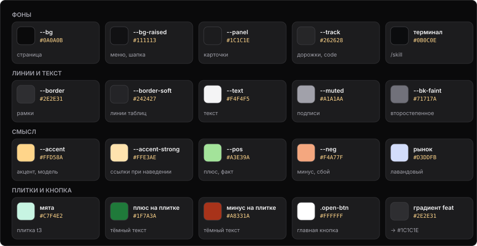

docs › DESIGN_SYSTEM.md

🎨 &nbsp;**DESIGN_SYSTEM.md**

# Дизайн-система

Как выглядит и как пишется сайт (`dashboard.py` + `app/templates/`). Меняешь страницу — сверяйся с этим файлом; добавил новый общий приём — допиши сюда.

---

### `01` &nbsp; Как устроено

Путь от браузера до страницы и из чего страница собрана.

<table>
<tr>
<td width="50%" valign="top">

### `02` &nbsp; Принципы

То, что важнее любого цвета.

1. **Деньги в долларах** через кошельки. Сравнение кошельков — доходность в % от поставленного.
2. **Ставки — сценариями**: «угадаем k из n → итог → шанс» (`scenarios()` в `dashboard.py`). Никаких «если всё выиграет» и абстрактных средних.
3. **Простой русский язык**, без жаргона. Подпись объясняет, что значит число.
4. **Свежесть данных видна**: у каждой страницы — когда обновлялось (`job_runs`); устаревшее — жёлтым.
5. **Тревоги — сверху красной плашкой** (`alerts`, `data/ALERT_DB_LOCKED`).
6. Внизу меню всегда: «paper trading · $0 реальных денег».
7. Тёмная тема, одна.

</td>
<td width="50%" valign="top">

### `03` &nbsp; Два набора стилей

Базовый каркас и более новый «bk».

| Набор | Где | Фон карточек |
|---|---|---|
| **Базовый** (`:root` в `base.html`) | каркас, меню | тёмно-синий `#0B192C` |
| **«bk»** (`.bk` в `paper.html`, `training.html` и др.) | `/paper`, `/training`, `/status`, `/bets`, `/events` | графитовый `#15181e`, крупнее шрифт (15px) |

Новые страницы с деньгами и кошельками — в наборе **bk** (он новее, 27.09). Цвета брать только из переменных; жёстко прописанные цвета — только внутри графиков SVG (см. `09`).

</td>
</tr>
</table>

### `04` &nbsp; Цвета

Палитра «Графит и пастель» — выбрана Alex 27.09 по макету Payoneer (раньше: `#FF6500 / #1E3E62 / #0B192C / #000000`). Графитовые фоны, пастельные акценты. Базовый набор и bk теперь одного цвета.

<table>
<tr>
<td width="50%" valign="top">

**Базовый** (`base.html`)

| Переменная | Цвет | Для чего |
|---|---|---|
| `--bg` | `#0A0A0B` | фон страницы |
| `--bg-raised` | `#111113` | меню, шапка |
| `--panel` | `#1C1C1E` | карточки, блоки |
| `--track` | `#262628` | дорожка полос, `code` |
| `--border` / `--border-soft` | `#2E2E31` / `#242427` | рамки / линии таблиц |
| `--text` / `--muted` | `#F4F4F5` / `#A1A1AA` | текст / подписи |
| `--accent` / `--accent-strong` | `#FFD58A` / `#FFE3AE` | акцент, ссылки, рынок на полосах |
| `--highlight` | `#FFD58A` | точка логотипа, предупреждения |
| `--pos` / `--neg` | `#A3E39A` / `#F4A77F` | плюс / минус |
| `--pos-bg` / `--neg-bg` / `--accent-bg` | те же, 14% | фон плашек |

</td>
<td width="50%" valign="top">

**bk** (`.bk`)

| Переменная | Цвет | Для чего |
|---|---|---|
| `--bk-card` / `--bk-raise` | `#1C1C1E` / `#262628` | карточка / вложенный блок |
| `--bk-line` | `#2E2E31` | линии |
| `--bk-text` / `--bk-muted` / `--bk-faint` | `#F4F4F5` / `#A1A1AA` / `#71717A` | текст / подписи / совсем второстепенное |
| `--bk-accent` | `#FFD58A` | акцент, ссылки, модель на графиках |
| `--bk-pos` / `--bk-neg` | `#A3E39A` / `#F4A77F` | выигрыш / проигрыш (салатовый / персиковый) |
| `--bk-gold` | `#FFD58A` | «устарело», тег «главная модель» (сплошной, тёмный текст) |

Главная кнопка (`.open-btn`) — белая `#FFFFFF` с тёмным текстом, как в макете.

</td>
</tr>
</table>

> [!NOTE]
> **Смысл цвета постоянный:** салатовый — заработали/модель права, персиковый — потеряли/сбой, янтарный — модель и
> акцент, лавандовый `#D3DDFB` — рынок, салатовый — факт, янтарный — внимание.

<table>
<tr>
<td width="50%" valign="top">

### `05` &nbsp; Шрифт и числа

Один шрифт, числа в столбик.

- Везде **Onest** (Google Fonts, 400/500/600/700), и для текста, и для цифр.
- Числа в столбик — `font-variant-numeric: tabular-nums` (класс `.num` в bk).
- Размеры: основной 14px (базовый) / 15px (bk); подписи 12-13.5px; заголовок страницы 26px; заголовок раздела 19px; большая сумма кошелька 44px (36px на телефоне).
- Деньги: `money_str()` → `+$1.23` / `−$1.23` (настоящий минус «−», всегда со знаком, 2 знака).
- Шансы и цены — в центах или процентах целыми: `34¢`, `62%`.

</td>
<td width="50%" valign="top">

### `06` &nbsp; Иконки и логотип

Свой набор SVG и файлы Alex.

- Свой набор SVG в `app/templates/_icons.html` (в стиле Lucide, линии 2px): `wallet`, `weather`, `target`, `sliders`, `status`, `menu` и др. Вызов: `{{ icon.render('wallet') }}`. Размер 18px, цвет — `currentColor`.
- **Логотип** (файлы Alex, 28.09) — `app/static/`, сайт отдаёт по `/static/…`:
  - `weather-lab-logo.svg` (значок + «weather lab», высота 34px) — в панели;
  - `weather-lab-icon.svg` — в свёрнутой панели, в шапке телефона и как значок вкладки;
  - `weather-lab-icon-512.png` — `/favicon.ico` и значок на экране телефона;
  - `weather-lab-mark.svg` — термометр без фона (запас).
- Термометр белый (#F4F4F5) с жёлтым (#FFD58A) — цвета палитры, не менять.

</td>
</tr>
</table>

### `07` &nbsp; Компоненты

Готовые приёмы: класс, где живёт, правило.

| Компонент | Класс | Где | Правило |
|---|---|---|---|
| Блок | `.block` (базовый), `.pane` (bk) | везде | скругление 14-16px, внутренний отступ 22-24px |
| Состояние | `.st.ok/.warn/.bad/.none` | `/status` | округлая, точка + слово: работает / опаздывает / ошибка / нет данных |
| Итог страницы | `.verdict.ok/.bad` | `/status` | зелёный «Всё работает» или красный список проблем |
| Метка итога | `.mark.won/.lost` | история | «выиграли / проиграли» |
| Счёт кошелька | `.acct`, `.big`, `.split` | `/paper?w=` | сумма крупно, под ней 3 числа |
| Цель | `.goal` + `.meter` | `/paper` | полоска «до решения о реальных деньгах» (150 ставок) |
| Сценарии | `.scen`, строка `.likely` | `/paper?w=` | самый вероятный сценарий подсвечен оранжевой полосой слева |
| Ставки | `.bets` | `/paper?w=` | на телефоне таблица становится карточками (`data-l` — подпись поля) |
| Карточка кошелька | `a.wal` + `.spark` | обзор `/paper` | имя, баланс, мини-график, доходность, «насколько права» |
| Главный кошелёк | `a.feat` | обзор `/paper` | градиент `#1E3E62 → #0B192C`, кнопка `.open-btn` |
| Группа кошельков | `.grp-box` + `.grp` | обзор `/paper` | заголовок с оранжевой полосой и счётчиком |
| Свежесть | `.fresh` > `.fr` (`.stale`, `.none`) | `/paper` | зелёная точка мигает, устаревшее — жёлтым |
| Тревоги | `.alerts` | `/paper`, `/training` | красная рамка, `role="alert"` |
| Свёрнутый раздел | `details.fold` | `/paper` | стрелка справа, высота заголовка 56px |
| «Как работает кошелёк» | `details.fold.doc` + `.doc-grid` | `/paper?w=` | текст из `app/wallet_docs.py` |
| Шаги | `ol.how` | описания | номер в оранжевом квадрате |
| Крупная сумма | макрос `cash_big` → `.mb` + `.cents` | балансы на `/paper` | центы бледнее (`--bk-faint`); анимация «набегания» обновляет обе части |
| Пастельные плитки | `.tiles` > `.tile.t1/.t2/.t3` | счёт кошелька | лавандовая `#D3DDFB` / янтарная `#FFD58A` / мятная `#C7F4E2`, тёмный текст; плюс/минус — `#1F7A3A` / `#A8331A` |
| Полоска из делений | макрос `segbar(n, need)` → `.segbar` | «до реальных денег» | 30 делений, заполненные — салатовые (`--bk-pos`) с лёгким угасанием |
| Метка статуса | макрос `chip('in'/'out'/'wait', текст)` → `.chip` | итоги ставок | иконка-стрелка: ↙ зелёная «угадали», ↗ красная «не угадали», часы — «ждём» |
| Дата квадратиком | макрос `dbadge(дата)` → `.dbadge` | списки ставок | месяц мелко сверху («СЕН»), число крупно |
| Итог по дням | `.week` > `.wk` (функция `week_bars`) | страница кошелька | 7 дней маркетов; плюс — салатовый столбик вверх от пунктирной нулевой линии, минус — персиковый вниз, сумма над/под столбиком |
| Круглый значок кошелька | `.wb.g1…g5` | `/bets` | сокращение кошелька (v3, MX, CP…), цвет — по группе: янтарный главная, лавандовый версии, серый формулы, мятный «своя заявка», персиковый copy и замеры |
| Лента событий | `.feed` + `.ic.k-*` | `/events` | время слева, иконка в кружке цвета события, фильтры-кнопки сверху (`aria-pressed`) |
| Изменение баланса | макрос `move` → `.mv.up/.down/.flat` (функция `last_move`) | рядом с балансом на `/paper` | ▲ салатовый / ▼ персиковый — итог последнего расчёта ставок (закрытых в одну минуту); в подсказке время и число ставок |
| Карточка кошелька | `a.wal` > `.wb-chart`, `.wb-money`, `.wb-stats`, `.wb-hist`, `.wb-foot` | обзор `/paper` | без описания (оно на странице кошелька); отдельные блоки: график с итогом и строкой случайности (`.wb-chart`), деньги (свободно / в ставках), результаты 2×2 (сыграно, угадано, ждут, доходность), «на истории»; внизу слева «▲ лучше / ▼ хуже рынка ±N%» — только по настоящим закрытым ставкам кошелька, в деньгах (выплата к потраченному без комиссии); меньше 20 ставок — «мало ставок: N из 20»; справа время. Под итогом — «в пределах случайности (±$N)» / «скорее реальный плюс·минус» / «не случайный» (`dashboard.luck`: размах √Σ ставка²(1−цена)/цена, границы 1 и 2 размаха); то же на плитке «Итог закрытых ставок» |
| Пусто | `.empty` | везде | серый текст по центру, объясняет почему пусто |
| Боковая панель | `.sidebar` > `.side-block` (шапка, разделы без подписи, «Инструменты», paper trading) | все страницы | по макету Fundcy: один общий блок, внутри — отдельные блоки «Меню» и «Инструменты»; активный пункт — белая плашка; счётчики `.side-n` (кошельки, открытые ставки, тревоги, итог проверки — `nav_counts()`, кэш 60 с); кнопка «свернуть» (до иконок, запоминается в localStorage); поиска нет (убран 06.10, решение Alex) |
| Остаток кошелька | `.wal-cash` / `.wal-cash.low`, `.cash-warn` | `/paper` | «свободно для ставок $X»; меньше $2 — персиковым «новых ставок не будет» |
| Терминал логов | `.term-box` > `.term-bar` + `.term-pre` | `/skill` | графитовая консоль (`#0B0C0E`), шапка с точкой статуса и высотой 380px (320px на телефоне), умный автоскролл |

<table>
<tr>
<td width="50%" valign="top">

### `08` &nbsp; Живое обновление

Страницы обновляются сами, с 28.09.

Без индикатора и без перезагрузки — `base.html` слушает `/api/stream` (сигнал приходит только при настоящих изменениях данных) и **точечно** обновляет `<main>` (`morph`): меняются только отличающиеся тексты и атрибуты, элементы остаются те же — обработчики и анимации не перезапускаются, скрипты страницы заново не выполняются.

У существующих элементов сохраняются `aria-selected` / `aria-pressed` / `aria-expanded`, `hidden`, `open` и классы `sel` / `active` / `on` / `flash`; поля ввода не трогаются. Поэтому выбор вкладок/фильтров отмечать этими атрибутами/классами, а не другими.

</td>
<td width="50%" valign="top">

### `09` &nbsp; Графики

SVG с сервера, без JS-библиотек.

- Рисуются **сервером в SVG** (`dashboard.py` считает точки), без JS-библиотек.
- Линия баланса — оранжевая `#FF6500`, заливка под ней 10%; последняя точка «дышит».
- Точки: зелёная — день в плюс, красная — в минус.
- Сравнение: модель `#FF6500`, рынок `#8FB3DE`, факт `#199E70` (толще).
- Сетка — `--bk-line`, подписи осей — `--bk-muted`, 12px (17px на телефоне).
- Подсказка при наведении — `.viz-tip` (чёрный фон, число жирно сверху).
- Легенда — `.key` (короткая черта цвета серии) или `.legend-dot`.

</td>
</tr>
</table>

### `10` &nbsp; Сетка и экраны

Три ширины экрана.

| Ширина | Что меняется |
|---|---|
| > 900px | меню слева 240px, контент до 1120px, отступы 28×32px |
| ≤ 900px | меню прячется в «бутерброд» сверху; двухколоночные блоки → одна колонка |
| ≤ 640-600px | отступы меньше, таблица ставок → карточки, крупнее подписи графиков |

Сетки карточек: `repeat(auto-fill, minmax(250-270px, 1fr))`, промежуток 10-14px.
Отступы: кратные 2px, обычно 8 / 12 / 16 / 22-24 / 28-36px между разделами.
Скругления: 999px (плашки), 8px (пункты меню), 12px (карточки), 14-18px (блоки).

<table>
<tr>
<td width="50%" valign="top">

### `11` &nbsp; Доступность и движение

Каждому видно и удобно.

✅ Ссылка «Перейти к содержимому», рамка фокуса 2px оранжевым, `aria-current` у активного пункта 
✅ Цели касания ≥ 40-44px 
✅ Анимации (появление блоков, прорисовка линий, мигание «онлайн», заполнение полоски) — **только в `@media (prefers-reduced-motion: no-preference)`** 
✅ Цвет не единственный носитель смысла: у чисел всегда знак `+/−`, у итогов — слово

</td>
<td width="50%" valign="top">

### `12` &nbsp; Как добавить страницу

Четыре шага.

① Шаблон `app/templates/<имя>.html`, ``, содержимое в `
` 
② Маршрут в `dashboard.py` (`@app.get`), короткое соединение с базой, `rollback()` при ошибке 
③ Пункт в меню — `navlink(...)` в `base.html` 
④ Адрес в список страниц `check.sh` (строка `for u in / /status ...`); `./check.sh` → «ПРОВЕРКА ПРОЙДЕНА»

</td>
</tr>
</table>
