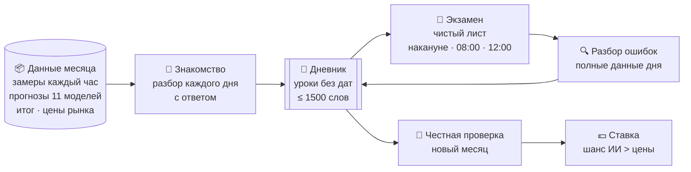

<div align="right"><sub>🧭 Цель · ясный порядок · проверка до денег</sub></div>

# 📓 ИИ с дневником

ИИ учится понимать погоду одного города на опыте. Она разбирает каждый час, записывает уроки в дневник и сдаёт экзамены
без памяти. Потом ставит на Polymarket там, где её шанс выше цены.

> **Статус:** готово к пробе · **город:** Атланта (KATL, °F) · **движок:** Gemma 4 26B → Gemini · **решение Alex 21.10**

---

## 01 · Как это работает

<sub>Вся система на одной схеме</sub>



| | Что делает ИИ | Что видит |
|---|---|---|
| 📖 **Знакомство** | идёт по дню час за часом: почему росло и падало, что задало максимум, где ошиблись прогнозы | весь день **с ответом** |
| 📝 **Экзамен** | оценивает максимум дня и шанс каждого варианта маркета | дневник и то, что было известно **в момент ставки** |
| 🔍 **Разбор** | ищет, что прочла не так, какой урок подвёл | дни с ошибкой **с ответом** и свои ответы |
| 📓 **Дневник** | сводит уроки: объединяет, выкидывает вредные | только свои уроки, **без дат** |

---

## 02 · Из чего собрано

<sub>Источники и инструменты</sub>

| | Часть | Что даёт |
|---|---|---|
| 🌡️ | **Замеры станции** · Iowa Mesonet | каждый замер METAR: температура, точка росы, влажность, ветер и порывы, давление, видимость, облака по высотам, явления (дождь, туман), осадки |
| 🛰️ | **Прогнозы** · Open-Meteo previous-runs | максимум дня от 11 моделей (ECMWF, GFS, ICON, NBM…), **выпущенный накануне** — без подглядывания |
| ☁️ | **Условия днём** · ECMWF | облачность, точка росы, солнце, ветер, осадки 11-17 ч |
| 🎯 | **Итог** · Polymarket | выигравший вариант маркета |
| 💲 | **Цены** · Polymarket | цена каждого варианта в момент ответа: для сравнения и денег |
| 🧠 | **Движок** · Gemma 4 26B на ПК Alex | бесплатно; на ней отлаживаем порядок |
| ✨ | **Движок** · Gemini (agy) | сильнее; итоговые прогоны, когда порядок отлажен |

---

## 03 · Где что лежит

<sub>Код в репозитории, данные только на сервере</sub>

```text
weather-lab/
├── app/diary_lab.py          # вся логика: данные, знакомство, экзамен, разбор, оценка
├── diary_run.sh              # запуск в фоне
├── docs/DIARY.md             # этот документ
└── data/research/diary/      # (не в git)
    └── atlanta/
        ├── data_2025-12.json # данные месяца: замеры, прогнозы, итоги, цены
        ├── diary.md          # дневник сейчас
        ├── history/          # каждая версия дневника
        ├── exam_<месяц>_<круг>.jsonl  # ответы экзаменов
        └── calls.jsonl       # каждый запрос к ИИ: ответ, размышление, время
```

---

## 04 · Порядок по шагам

<sub>Один месяц учёбы и проверка на следующем</sub>

| # | Шаг | Месяц | Зачем |
|:-:|---|---|---|
| ① | **Контроль r0** — экзамен без дневника | декабрь 2025 | с чем сравнивать |
| ② | **Знакомство** — 24 дня с ответом, уроки раз в неделю сводятся в дневник | декабрь | первый дневник |
| ③ | **Круг r1** — экзамен → разбор ошибок → правка дневника | декабрь | учёба |
| ④ | **Круг r2** — то же | декабрь | учёба |
| ⑤ | **Круг r3** — то же | декабрь | учёба |
| ⑥ | **Финал** — экзамен по декабрю | декабрь | насколько выучила месяц |
| ⑦ | **Проверка n1** — экзамен с дневником, без разбора | **январь 2026** | ⭐ главный ответ: помогает ли дневник на новых днях |
| ⑧ | **Контроль n1_empty** — тот же экзамен без дневника | январь 2026 | честное сравнение |

> 🔒 **Изоляция.** ИИ ничего не помнит между запросами. Каждый ответ экзамена — новый запрос: в нём только дневник и
> данные до момента ставки. Даты и дни недели автоматически вырезаются из дневника.

**Три момента ответа:**

```mermaid
timeline
    title Что ИИ знает в каждый момент
    Накануне 18:00 : прогнозы моделей : замеры прошлых дней
    08:00 : + замеры ночи и утра
    12:00 : + замеры до полудня : уже набранный максимум
```

---

## 05 · Как поймём, что работает

<sub>Порог записан 21.10 до первого прогона (RESEARCH_JOURNAL)</sub>

| | Проверка | Проходит, если |
|---|---|---|
| 🧪 | **Проба 3 дня** | ≥ 90% ответов в нужном виде; меряем время |
| 📓 | **Дневник помогает** | январь: с дневником лучше, чем без, в 2 из 3 моментов (logloss ниже на ≥ 0.05, промах не больше) |
| 📈 | **Лучше рынка** | январь: logloss ИИ ниже, чем у цены рынка в тот же момент |
| 💵 | **Деньги** | учёба до июля 2026, проверка 21.08-20.10.2026 по **настоящим сделкам**: ≥ 30 ставок, доходность ≥ +5% |
| 🚀 | **Кошелёк** | всё выше прошло → кошелёк `diary_atl` (решение Alex) |

**Ставка из ответа ИИ:**

```text
ИИ: «64-65°F — 55%»      рынок: 64-65°F стоит 40¢
55% − 40% = 15 п.п. ≥ 10  →  покупаем «да» на 64-65°F
```

Мерки: **logloss** — насколько ИИ была уверена в выигравшем варианте (меньше — лучше); **промах** — на сколько градусов
ошиблась с максимумом; **формула** — простое сравнение: средний прогноз моделей ± 3°F, днём не ниже уже набранного.

---

## 06 · Что дальше

<sub>Если проверка пройдёт</sub>

- ⬜ Отладить порядок на Gemma (проба 3 дня → декабрь → январь)
- ⬜ Тот же декабрь-январь на Gemini: сильнее ли дневник у сильной модели
- ⬜ Учёба по месяцам до июля 2026, проверка деньгами на 21.08-20.10.2026
- ⬜ Скилл на основе дневника: то, что помогло, — в инструкцию и программы
- ⬜ Другие города: свой дневник на каждый или общий + городской
- ⬜ Живой кошелёк: ставка сразу после ответа ИИ

> ⚠️ **Честно о шансах.** Рынок к 08:00 пока не обогнал ни один наш подход. Ставки накануне дали −14% (рынок точнее).
> Плюс есть только днём, по замерам (ml_day). Поэтому смотрим все три момента: где дневник даст преимущество — там и ставим.

<sub>Код: `app/diary_lab.py` · запуск: `./diary_run.sh cycle atlanta 2025-12 2026-01` · порог: `docs/RESEARCH_JOURNAL.md` 21.10</sub>
