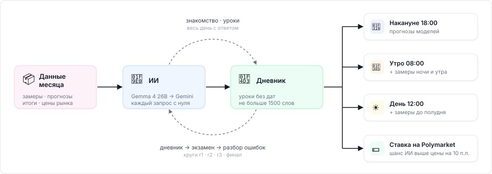

<sub>docs › DIARY.md</sub>


📓 &nbsp;**DIARY.md**

# Дневник ИИ

<sub>Как ИИ учится понимать погоду одного города, сдаёт экзамены и ставит на Polymarket там, где знает больше рынка.</sub>

---

### `01` &nbsp; Как устроено

<sub>Вся система на одной схеме: данные, ИИ, дневник и три момента ставки.</sub>



<table>
<tr>
<td width="50%" valign="top">

### `02` &nbsp; Из чего собрано

<sub>Источники и инструменты.</sub>

| | Часть | Что даёт |
|:-:|---|---|
| 🌡️ | **Замеры** | Iowa Mesonet: каждый METAR — t°, роса, ветер, давление, облака, дождь |
| 🛰️ | **Прогнозы** | Open-Meteo: 11 моделей, выпуск накануне |
| ☁️ | **Условия** | ECMWF: облака, солнце, ветер 11-17 ч |
| 🎯 | **Итог** | Polymarket: выигравший вариант |
| 💲 | **Цены** | Polymarket: цена в момент ответа |
| 🧠 | **Gemma 4** | виртуальная машина на NAS, бесплатно — отладка |
| ✨ | **Gemini** | agy — итоговые прогоны |
| 🟣 | **Opus 5.5** | `DIARY_ENGINE=claude`: контейнер без инструментов, подписка; месяцы только после июня 2026 |

</td>
<td width="50%" valign="top">

### `03` &nbsp; Где что лежит

<sub>Код в репозитории, данные только на сервере.</sub>

```text
weather-lab/
├─ app/diary_lab.py    # вся логика
├─ diary_run.sh        # запуск в фоне
├─ docs/DIARY.md       # этот документ
└─ data/research/diary/   (не в git)
   └─ atlanta/
      ├─ data_<месяц>.json  # данные
      ├─ diary.md           # дневник
      ├─ history/           # версии
      ├─ exam_*.jsonl       # экзамены
      ├─ calls.jsonl        # все запросы
      ├─ live.jsonl         # мысли модели по строкам
      └─ status.json        # что запущено, этап
```

</td>
</tr>
<tr>
<td width="50%" valign="top">

### `04` &nbsp; Порядок шагов

<sub>Месяц учёбы — декабрь 2025, проверка — январь 2026.</sub>

① **Контроль** — экзамен без дневника<br>
② **Знакомство** — каждый день с ответом → дневник<br>
③ **Круг 1** — экзамен → разбор ошибок → правка<br>
④ **Круг 2** — то же<br>
⑤ **Круг 3** — то же<br>
⑥ **Финал** — экзамен по декабрю<br>
⑦ **Проверка** — январь с дневником ⭐<br>
⑧ **Контроль** — январь без дневника

</td>
<td width="50%" valign="top">

### `05` &nbsp; Что дальше

<sub>Если проверка пройдёт.</sub>

✅ Данные декабря и января собраны<br>
✅ Программа и порог готовы<br>
✅ Проба 3 дня на Gemma — 22.10: форма 97%, 3 ч; дневник пока не помог (RESEARCH_JOURNAL.md)<br>
⬜ Проба Opus против Gemma: 3 дня августа → сентябрь 2026 (`atlanta_opus`, `atlanta_gemma`) — 22.10<br>
⬜ Полный цикл — 23.10<br>
⬜ Тот же цикл на Gemini<br>
⬜ Учёба до июля 2026, деньги на авг-окт 2026<br>
⬜ Скилл из дневника, другие города<br>
⬜ Дообучение малой модели (~8B) на ответах с дневником — 2060 Super<br>
⬜ Прошло → сервер RX 7900 XTX, дообучение большой<br>
⬜ Живой кошелёк `diary_atl`

</td>
</tr>
</table>

### `06` &nbsp; Как поймём, что работает

<sub>Порог записан 21.10 до первого прогона — docs/RESEARCH_JOURNAL.md.</sub>

| | Проверка | Проходит, если |
|:-:|---|---|
| 🧪 | **Проба 3 дня** | ≥ 90% ответов в нужном виде, меряем время |
| 📓 | **Дневник помогает** | январь: с дневником лучше, чем без, в 2 из 3 моментов (logloss ниже на ≥ 0.05, промах не больше) |
| 📈 | **Лучше рынка** | январь: logloss ИИ ниже, чем у цены рынка в тот же момент |
| 💵 | **Деньги** | по настоящим сделкам 21.08-20.10.2026: ≥ 30 ставок, доходность ≥ +5% |
| 🚀 | **Кошелёк** | всё выше прошло → `diary_atl`, решение Alex |

<table>
<tr>
<td width="50%" valign="top">

### `07` &nbsp; Изоляция

<sub>Почему экзамен честный.</sub>

🔒 Каждый ответ — новый запрос: только дневник и данные **до момента ставки**<br>
✂️ Даты и дни недели вырезаются из дневника<br>
➕ Дневник только дополняется: старые уроки не стираются, подведший урок получает пометку «misled me N×»<br>
🆕 Главный ответ — месяц, который ИИ не видела<br>
🧱 Opus — в контейнере без поиска, интернета, команд и файлов; месяцы после конца его знаний (июнь 2026)

</td>
<td width="50%" valign="top">

### `08` &nbsp; Ставка из ответа

<sub>Где ИИ знает больше рынка.</sub>

```text
ИИ:    64-65°F — 55%
Рынок: 64-65°F — 40¢
55 − 40 = 15 п.п. ≥ 10 → покупаем
```

</td>
</tr>
</table>

> [!WARNING]
> **Честно о шансах.** Рынок к 08:00 пока не обогнал ни один наш подход, ставки накануне дали −14%. Плюс есть только
> днём, по замерам (ml_day). Поэтому смотрим все три момента — где дневник даст перевес, там и ставим.

<sub>Смотреть ход: страница **/diary** — этапы, дневник и его версии, графики против рынка, живой терминал со временем каждой строки · запуск: `./diary_run.sh cycle atlanta 2025-12 2026-01` · проба: `--days=3` · мерки: logloss — уверенность в выигравшем варианте (меньше — лучше), промах — ошибка максимума в °F</sub>
